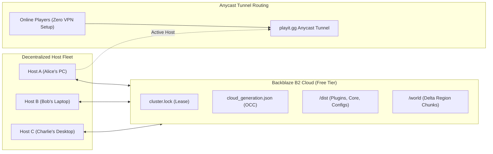

# Minecraft Cluster Orchestrator (v2.1)

[](https://github.com/WwFour13/mc-cluster-orchestrator/releases)
[](https://adoptium.net/temurin/releases/?version=21)
[]()
[]()
[]()
[]()

A distributed, fail-safe Minecraft server orchestrator. Coordinates 24/7 multiplayer hosting across multiple friends' PCs with **zero server rental costs**, **zero player VPNs** (no Hamachi, Radmin, or port forwarding required), and optimistic concurrency cloud synchronization using a free Backblaze B2 bucket.

> **Looking for the Setup Guide?**  
> Check out [**INSTRUCTIONS.md**](INSTRUCTIONS.md) for quick-start guides, co-host onboarding steps, invite key usage, and administrative runbooks.

---

## The Vision & Core Capabilities

Traditional community Minecraft servers face an unfortunate trade-off: pay recurring monthly fees for dedicated cloud hosting, or leave one friend's noisy gaming PC powered on 24/7.

**Minecraft Cluster Orchestrator** eliminates both limitations by turning a group of friends' PCs into a decentralized hosting cluster:



* **Zero Recurring Cost**: Operates entirely within the free tier of Backblaze B2 (10 GB free storage, 1 GB daily free egress) and Playit.gg Anycast tunneling.
* **Decentralized Handoff**: Any authorized friend can start the server when they want to play. When they shut down, their latest save generation is atomically committed to the cloud for the next host.
* **Zero-Config Onboarding**: New co-hosts paste an `mc-cluster://...` invite key or import an offline `cohost-starterpack.zip` to onboard in under 30 seconds.
* **Player Transparency**: Players connect to a permanent domain (e.g. `smp.playit.gg` or DuckDNS domain). The tunnel dynamically points to whichever friend is actively hosting.

---

## What's New in v2.1

* **Autonomous Cloud Storage Hygiene (`rclone cleanup`)**:
  Minecraft chunk autosaves constantly rewrite region files (`.mca`), which historically accumulated thousands of hidden revisions on Backblaze B2. The orchestrator now performs autonomous garbage collection sweeps on server shutdown, pruning dead revisions while keeping the active live save 100% safe.
* **Native Emoji Dual-Font Rendering Engine**:
  Custom `ModernButton` typography pipeline resolves icons via Windows `Segoe UI Emoji` and labels via `Segoe UI Bold` with visual-bounds centering, eliminating missing-glyph boxes (`[▯]`).
* **Vivid 4-Color Operational Suite**:
  * ⛔ **`REQUEST REMOTE STOP`**: Crimson Red (`#ef4444`)
  * 🔓 **`EMERGENCY FORCE UNLOCK`**: Amber Gold (`#f59e0b`)
  * ☁️ **`SYNC CONFIGS & PLUGINS`**: Royal Blue (`#3b82f6`)
  * 🧹 **`CLEAN CLOUD STORAGE`**: Vibrant Violet (`#8b5cf6`)
* **Zero-Egress Cohost Starter Packs (`cohost-starterpack.zip`)**:
  Export complete game worlds, plugins, Paper runtime, and launchers into an offline archive to onboard co-hosts without consuming cloud bandwidth.
* **Native Win32 GUI Launcher (`MinecraftCluster.exe`)**:
  Native Windows GUI binary with embedded icon, silent background execution (zero flashing CMD windows), and self-healing update loops.

---

## Concurrency & Safety Guardrails

Hosting a shared world across multiple physical machines requires ironclad concurrency safeguards to prevent split-brain states, overwrites, or data corruption:

| Safeguard | How It Works |
| :--- | :--- |
| **Distributed Cloud Lock** | Coordinates the active host via `cluster.lock` in Backblaze B2. If a co-host attempts to start while another machine is hosting, launch safely aborts in-GUI. |
| **Optimistic Concurrency (OCC)** | Tracks sequential generation numbers (`manifest.json` and `cloud_generation.json`). Local states must match or advance cloud generations, physically blocking rollbacks. |
| **Heartbeat & Stale Reclaim** | The active host pulses the cloud lock lease every 120 seconds. If a host suffers a blackout or hard crash, the lock expires after 10 minutes, allowing peers to reclaim the cluster. |
| **Dual-Layer Collision Guard** | Prior to boot, the orchestrator pings the public tunnel and sniffs for live players. If an active server is detected, boot aborts immediately to protect world state. |
| **Active Host Priority Gate** | If a new co-host with no local world files joins while a server is actively running, initial cloud downloads are paused to guarantee backup bandwidth for the live session. |
| **Autonomous Storage Hygiene** | Automatically executes cloud garbage collection on server stop, purging superseded chunk revisions to stay permanently within the 10 GB free tier. |
| **Anti-Downgrade Version Guard** | Enforces `min_orchestrator_version` in cloud manifests, barring outdated launcher binaries from touching newer world saves. |
| **Fail-Safe Rollback** | Backblaze B2 retains previous file revisions for 30 days, making accidental griefing or corruptions immediately reversible. |
| **ClusterGuard Plugin** | Custom Paper fail-safe plugin (`ClusterGuard.jar`) that detects and halts direct, un-orchestrated JAR invocations. |

---

## Graphical Interface Reference

The orchestrator includes a native dark-themed desktop application built with Java Swing:

```
┌────────────────────────────────────────────────────────────────────────┐
│ MINECRAFT CLUSTER v2.1.3      [ Dashboard ]  [ Cluster Admin ]  [ Settings ]│
├────────────────────────────────────────────────────────────────────────┤
│                                                                        │
│ Dorm Craft SMP — Shared Cluster                       ● Active on MSI  │
│ Host: Desktop-Alpha | Storage: C:\dev\minecraft-server       ⟳ Refresh │
│                                                                        │
│ ┌──────────────────────┐  Memory Allocation: 8 GB                      │
│ │ ▶ START CLUSTER SERVER│  [=====|============== 31 GB Total]           │
│ └──────────────────────┘  Connection: jensen-edited.tun.ply.gg [COPY]  │
│                                                                        │
│ 1. Up to Date   2. Lock Acquired   3. Synchronized   4. Ready   5. LIVE │
│ └──────────────────────────────────────────────────────────────────────┘
│                                                                        │
│ Live Server Console & Command Stream                                   │
│ ┌────────────────────────────────────────────────────────────────────┐ │
│ │ [12:47:10] [Server thread/INFO]: Preparing spawn area: 84%         │ │
│ │ [12:47:11] [Server thread/INFO]: Done (4.218s)! For help, type ... │ │
│ └────────────────────────────────────────────────────────────────────┘ │
│ Console: [ Type command (e.g. op Player, whitelist add Player)...   ]  │
└────────────────────────────────────────────────────────────────────────┘
```

### 1. Dashboard Tab
* **Cloud Radar Badge**: Live cluster status (`Cluster Available`, `Active on <Host>`, or `Hosting Session (Local)`).
* **Connection Address**: Sniffs live Anycast PlayIt tunnels (or DuckDNS domains) with a one-click copy button.
* **RAM Allocation Slider**: Smoothly adjusts server memory allocation dynamically bounded by system limits.
* **Milestone Progress Pipeline**: Visual feedback tracking the 5 pre-flight ignition milestones in real time.
* **Interactive Live Console**: Streams server logs with auto-scrolling and command dispatching.

### 2. Cluster Admin Tab
* **Invite Key Token**: Generates and displays encrypted `mc-cluster://...` keys for one-click friend onboarding.
* **Cohost Starter Pack**: One-click export and import of zero-egress offline starter bundles.
* **Operational Controls**:
  * ⛔ **`REQUEST REMOTE STOP`**: Broadcasts an in-game 30s countdown and orders a graceful shutdown and save.
  * 🔓 **`EMERGENCY FORCE UNLOCK`**: Reclaims stranded cloud locks after power outages or hard crashes.
  * ☁️ **`SYNC CONFIGS & PLUGINS`**: Pushes local plugins, YAML configs, and updated launchers to all peers.
  * 🧹 **`CLEAN CLOUD STORAGE`**: Purges dead historical chunk revisions on Backblaze B2.

### 3. Settings Tab
* Configure local server folders, update B2 credentials, customize heartbeat intervals, and adjust bandwidth limits.

---

## Repository Structure

```text
mc-cluster-orchestrator/
├── README.md                       <-- Architectural capabilities & technical specification
├── INSTRUCTIONS.md                 <-- Setup runbook for admins and co-hosts
├── src/
│   ├── ClusterGUI.java             <-- Modern 3-tab graphical desktop application
│   ├── ServerLauncher.java         <-- Core cloud sync engine, OCC coordinator & CLI
│   ├── ClusterRegistry.java        <-- Multi-cluster workspace profile manager
│   ├── ClusterToken.java           <-- Invite key encoder / decoder (mc-cluster://)
│   ├── GitHubUpdateChecker.java    <-- Self-updating release poller and downloader
│   └── PaperDownloader.java        <-- PaperMC automated binary fetcher
├── cluster-guard/                  <-- ClusterGuard fail-safe Paper plugin source
├── windows/
│   ├── build.bat                   <-- Local Java compiler & asset packager
│   ├── package_release_assets.ps1  <-- Assembles all platform release assets in out/release/
│   ├── package_jar.ps1             <-- Atomic JAR packager with file-lock retries
│   ├── installer/
│   │   └── Installer.cs            <-- WinForms installer (MinecraftClusterSetup.exe)
│   └── launcher/
│       └── Launcher.cs             <-- Native Win32 launcher (MinecraftCluster.exe)
├── templates/                      <-- Operational templates deployed to server runtimes
│   ├── icon.ico                    <-- Desktop and launcher icon
│   ├── rclone-filter.txt           <-- Session sync filter (world and player data)
│   ├── admin-dist-filter.txt       <-- Administrative distribution filter (plugins and configs)
│   ├── config.example.json         <-- Sample cluster configuration
│   ├── mac-linux/                  <-- macOS/Linux templates and scripts
│   └── windows/                    <-- Windows batch wrappers and shortcuts
└── out/
    └── release/                    <-- Built production release assets
        ├── MinecraftClusterSetup.exe
        ├── Minecraft-Cluster-Windows-Portable.zip
        ├── Minecraft-Cluster-macOS.zip
        ├── Minecraft-Cluster-Linux.zip
        ├── ServerLauncher.jar
        ├── ClusterGuard.jar
        └── install.sh
```

---

## Building from Source

### Prerequisites
* **Java 21 LTS** JDK (Eclipse Adoptium Temurin 21 recommended)
* **Windows (Optional for `.exe` compilation)**: .NET Framework 4.8 / `csc.exe` (included natively in Windows)

### Build Commands
From the repository root:

* **Windows**:
  ```cmd
  windows\build.bat
  ```
* **Packaging Release Assets**:
  ```powershell
  powershell -ExecutionPolicy Bypass -File "windows\package_release_assets.ps1"
  ```
  All platform output assets are generated in `out/release/`, ready to deploy or upload to GitHub Releases.

---

## Documentation & Quick Start Guides

Ready to configure or join a cluster? Refer to:
* [**INSTRUCTIONS.md**](INSTRUCTIONS.md) — Step-by-step setup guide for Co-Hosts and Administrators.

---

## License
Distributed under the MIT License. See `LICENSE` for more information.
